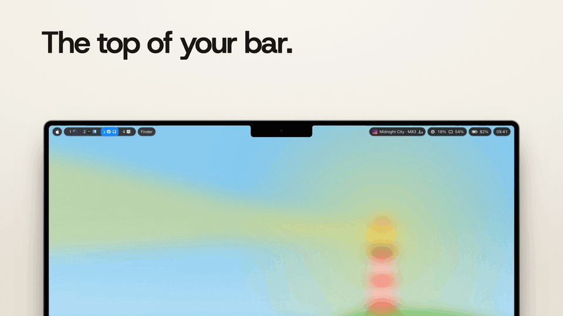
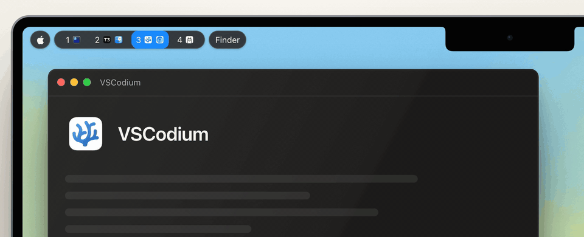
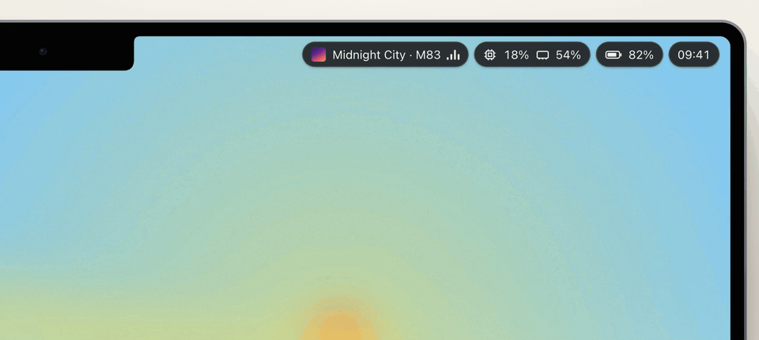
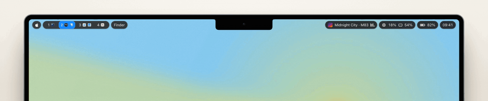
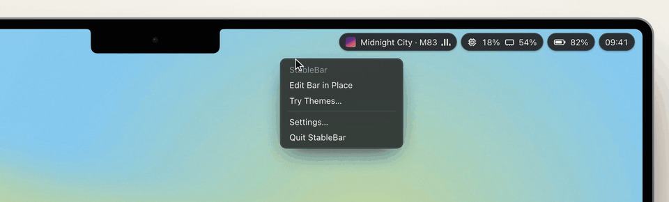
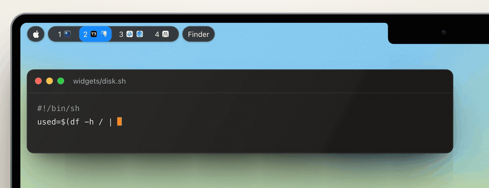
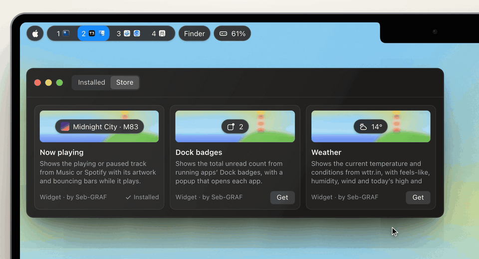
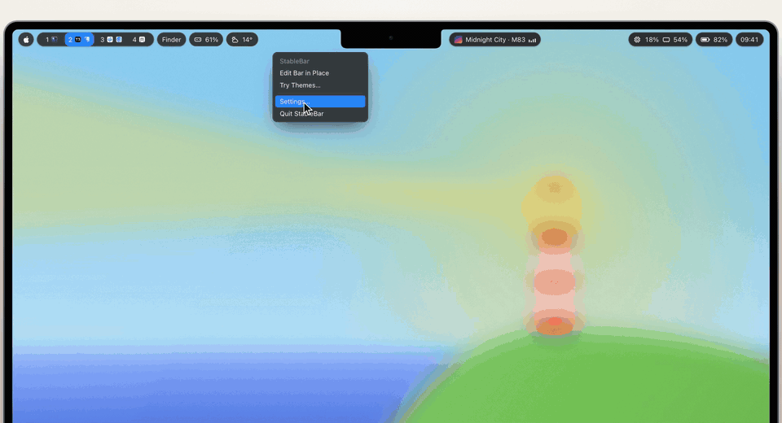

# StableBar

A native, configurable menu bar for macOS and an alternative to SketchyBar. Built with Swift, AppKit and SwiftUI.

[**Download for Mac**](https://github.com/Seb-GRAF/StableBar/releases/latest) · [Website](https://stablebar.app/) · [User guide](docs/README.md) · [Widget store](https://github.com/Seb-GRAF/stablebar-packages)

<p></p>

## Install

Download [StableBar.dmg](https://github.com/Seb-GRAF/StableBar/releases/latest), drag it to Applications and open it. Setup walks you through a preset, a theme and a placement.

Or install with [Homebrew](https://brew.sh):

```sh
brew install --cask seb-graf/tap/stablebar
```

**macOS 14+ · Apple silicon · Free and open source.** Releases update themselves. See [Getting started](docs/getting-started.md) for permissions, beta updates and uninstalling.

## Workspaces and popups

<p></p>

Follow your workspaces with [AeroSpace](https://github.com/nikitabobko/AeroSpace), [yabai](https://github.com/koekeishiya/yabai) or [OmniWM](https://github.com/OmniNull/OmniWM). Without a window manager, try the opt-in [macOS Spaces source](docs/widgets.md#macos-spaces-workspaces).

<p></p>

Keep the active app, calendar, system stats and playback controls in reach. Widgets can open popups with graphs, lists and controls. Each display gets its own bar, with room for the notch.

[Built-in widgets](docs/widgets.md) · [Custom popups](docs/popups.md) · [Multiple displays](docs/layout.md)

## Make it yours

<p></p>

Choose from Built-in and six bundled themes, or save your own.

<p></p>

Right-click the bar and choose **Edit Bar in Place** to drag widgets between positions, add them with **+** or remove them with **−**. Changes save as you go, with undo.

[Themes](docs/themes.md) · [Editing your bar](docs/settings.md)

## Add your widgets

<p></p>

Run a command that prints text or JSON, and its output becomes a widget. Refresh on a timer or on events.

<p></p>

Find widgets and themes in **Settings → Packages → Store**. StableBar shows a package's commands, hosts and permissions before anything runs.

[Create a widget](docs/create-a-widget.md) · [Packages and the store](docs/packages.md#store)

<details>
<summary>A shell script is enough</summary>

```sh
#!/bin/sh
# ~/.config/stablebar/widgets/disk.sh
used=$(df -h / | awk 'NR == 2 { print $5 }')
printf '{"text":"%s","icon":"internaldrive"}' "$used"
```

```json
{
  "id": "disk", "type": "script", "position": "right", "interval": 300,
  "command": "~/.config/stablebar/widgets/disk.sh"
}
```

</details>

## Settings or JSON

<p></p>

Change content, appearance and behavior in Settings, with undo and redo. Or edit `~/.config/stablebar/config.json`: StableBar applies it when you save and keeps the last working bar if a change is invalid. The JSON schema gives your editor completion and validation.

[Settings](docs/settings.md) · [Configuration](docs/configuration.md) · [Command line](docs/command-line.md) · [Example setups](examples)

<details>
<summary>A minimal configuration</summary>

```json
{
  "$schema": "https://raw.githubusercontent.com/Seb-GRAF/StableBar/main/stablebar.schema.json",
  "theme": { "id": "catppuccin" },
  "widgets": [
    { "id": "spaces", "type": "workspaces", "position": "left" },
    { "id": "app", "type": "activeApp", "position": "left" },
    { "id": "power", "type": "battery", "position": "right" },
    { "id": "clock", "type": "clock", "position": "right", "format": "EEE d MMM  HH:mm" }
  ]
}
```

</details>

## Contributing

Built by [Sebastien Graf](https://github.com/Seb-GRAF) and [Steve Mendes Reis](https://github.com/M4n0x), with help from [everyone who has contributed](https://github.com/Seb-GRAF/StableBar/graphs/contributors).

Bug reports, ideas and pull requests are welcome. [CONTRIBUTING.md](CONTRIBUTING.md) explains how to build StableBar, run the tests and open a pull request. Report security issues privately through [SECURITY.md](.github/SECURITY.md).

Available under the [MIT License](LICENSE), including commercial use and redistribution.

[](https://github.com/Seb-GRAF/StableBar/releases/latest)
[](https://github.com/Seb-GRAF/StableBar/actions/workflows/ci.yml)
