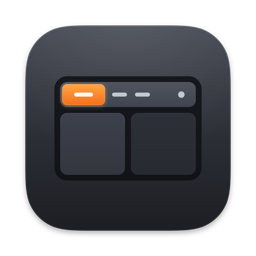
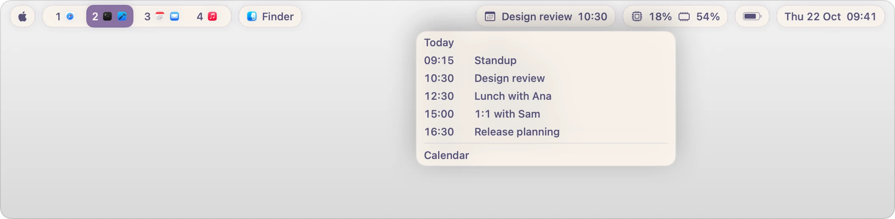
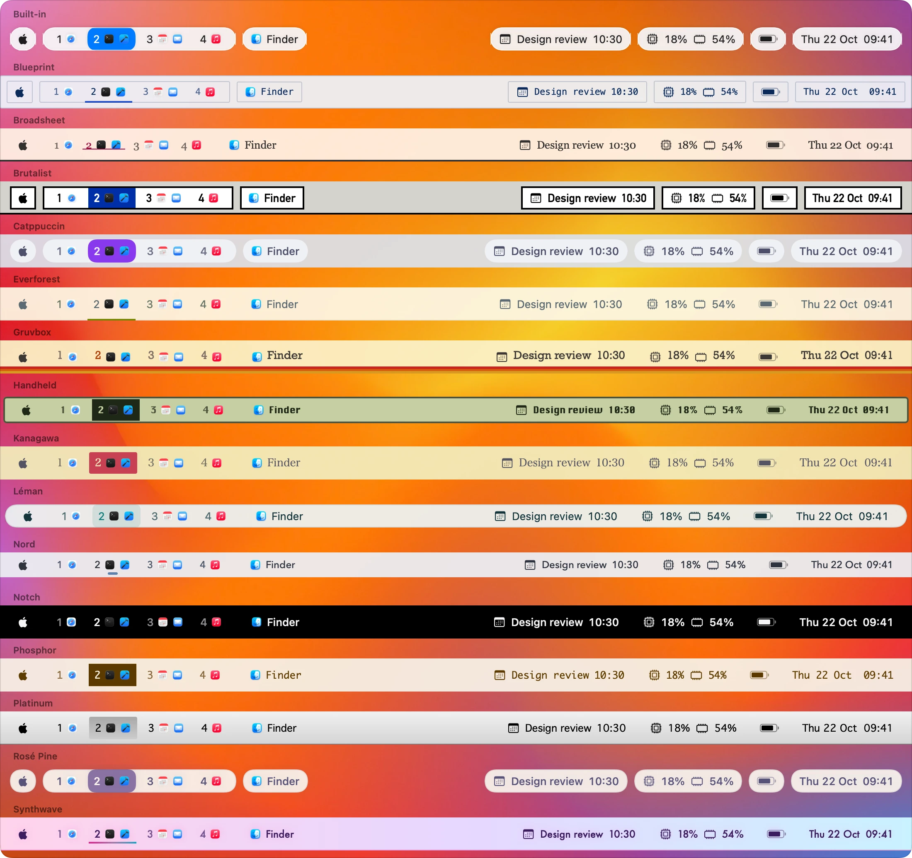
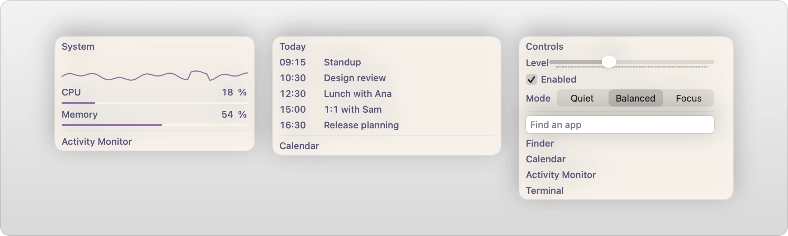
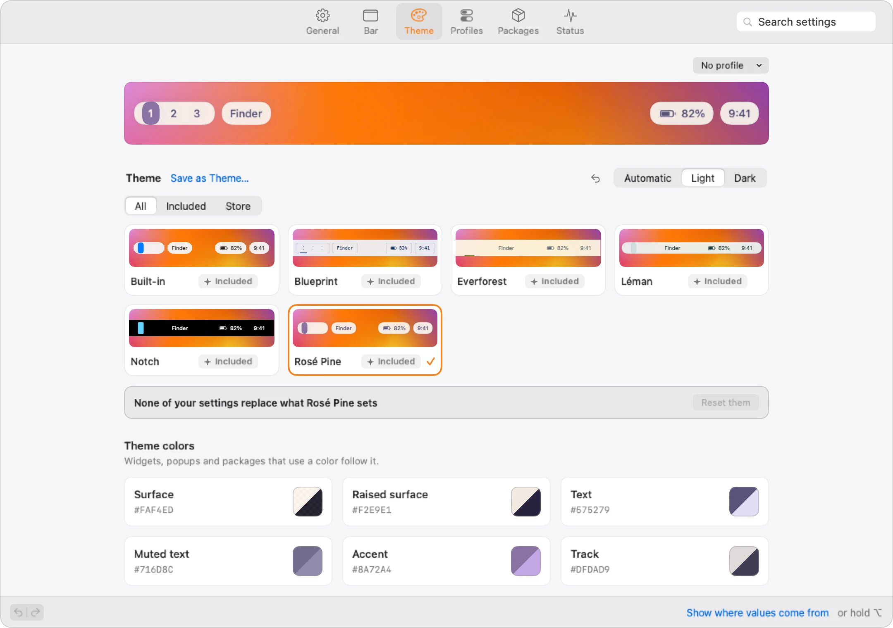

<div align="center">



# StableBar

A native, configurable bar for macOS.<br>
Themes, widgets and popups, set up in the app or in plain JSON.

[](https://github.com/Seb-GRAF/StableBar/releases/latest)
[](https://github.com/Seb-GRAF/StableBar/actions/workflows/ci.yml)
[](#install)
[](LICENSE)

[**Download**](https://github.com/Seb-GRAF/StableBar/releases/latest) · [User guide](docs/README.md) · [Widget store](https://github.com/Seb-GRAF/stablebar-packages) · [Examples](examples)

</div>

<br>

<picture>
  <source media="(prefers-color-scheme: dark)" srcset="docs/images/hero-dark.webp">
  
</picture>

## Features

- **Native.** Swift, AppKit and SwiftUI, with no web view or private window-server API, except in the opt-in [macOS Spaces](docs/widgets.md#macos-spaces-workspaces) workspace source. One panel per display; workspace changes update the widgets in place instead of recreating windows.
- **Guided setup.** Pick a preset, a theme and a placement, and watch each choice on your real bar. Then edit the bar in place, in Settings or in JSON.
- **Themes.** Six ship with the app and more come from the store. **Save as Theme…** turns your own look into one. Experimental Liquid Glass on macOS 26.
- **Built-in widgets.** Workspaces, app menus, the active app, clock, CPU and memory, network, battery, sound and calendar, without running a script.
- **Any script is a widget.** Print text or JSON from any language, refresh on a timer or on events, and open a popup with graphs, lists and controls.
- **Window managers.** Workspaces from [AeroSpace](https://github.com/nikitabobko/AeroSpace) or [yabai](https://github.com/koekeishiya/yabai). Without one, StableBar can keep windows and notifications clear of the bar.
- **Every display.** Notch-aware placement, widgets per kind of screen and a separate bar for each screen setup.
- **Scriptable.** The command line queries and edits the running bar and sends events from other tools.

## Themes

The same bar in each theme that ships with StableBar. Choose one during setup, cycle through them on your own bar with **Try Themes…**, or get more from the [store](https://github.com/Seb-GRAF/stablebar-packages).

<picture>
  <source media="(prefers-color-scheme: dark)" srcset="docs/images/themes-dark.webp">
  
</picture>

## Popups

Any widget can open a popup. Build it from rows, columns, text, graphs, lists, buttons, sliders, toggles and search fields, filled with the widget's data. See [Custom popups](docs/popups.md).

<picture>
  <source media="(prefers-color-scheme: dark)" srcset="docs/images/popups-dark.webp">
  
</picture>

## Settings

Change content, appearance and behavior without touching JSON. Settings saves to the same configuration file you can edit by hand, with undo and redo. See [Settings](docs/settings.md).

<picture>
  <source media="(prefers-color-scheme: dark)" srcset="docs/images/settings-dark.webp">
  
</picture>

## Install

1. Download `StableBar.dmg` from the [latest release](https://github.com/Seb-GRAF/StableBar/releases/latest).
2. Open it and drag StableBar to Applications.
3. Open StableBar. Setup walks you through a preset, a theme and a placement.

StableBar needs macOS 14 or later on Apple silicon. Releases update themselves; choose the Beta track in **Settings → General → Updates** to get betas. See [Getting started](docs/getting-started.md).

## Configure

Your bar lives in `~/.config/stablebar/config.json`. Setup and Settings save to it, and you can edit it yourself: StableBar applies the file when you save it, and keeps the last working bar if a change is invalid. The JSON schema gives editors completion and validation.

```json
{
  "$schema": "https://raw.githubusercontent.com/Seb-GRAF/StableBar/main/stablebar.schema.json",
  "theme": { "id": "rose-pine" },
  "widgets": [
    { "id": "spaces", "type": "workspaces", "position": "left" },
    { "id": "app", "type": "activeApp", "position": "left" },
    { "id": "power", "type": "battery", "position": "right" },
    { "id": "clock", "type": "clock", "position": "right", "format": "EEE d MMM  HH:mm" }
  ]
}
```

## Write a widget

A widget can run any command that prints text or a JSON object:

```sh
#!/bin/sh
# ~/.config/stablebar/widgets/disk.sh
used=$(df -h / | awk 'NR == 2 { print $5 }')
printf '{"text":"%s","icon":"internaldrive"}' "$used"
```

```json
{
  "id": "disk", "type": "script", "position": "right", "interval": 300,
  "command": "~/.config/stablebar/widgets/disk.sh"
}
```

[Create a widget](docs/create-a-widget.md) covers the output format, events and layouts. Share a widget as a [package](docs/packages.md), or install others from the store in **Settings → Packages**.

## Documentation

The [user guide](docs/README.md) documents every feature and configuration option. Start with [Getting started](docs/getting-started.md), or try one of the working setups in [examples](examples).

## Contributing

Bug reports, ideas and pull requests are welcome. [CONTRIBUTING.md](CONTRIBUTING.md) explains how to build StableBar, run the tests and open a pull request. Report security issues privately, as described in [SECURITY.md](.github/SECURITY.md).

## License

StableBar is available under the [MIT License](LICENSE), including commercial use and redistribution.
