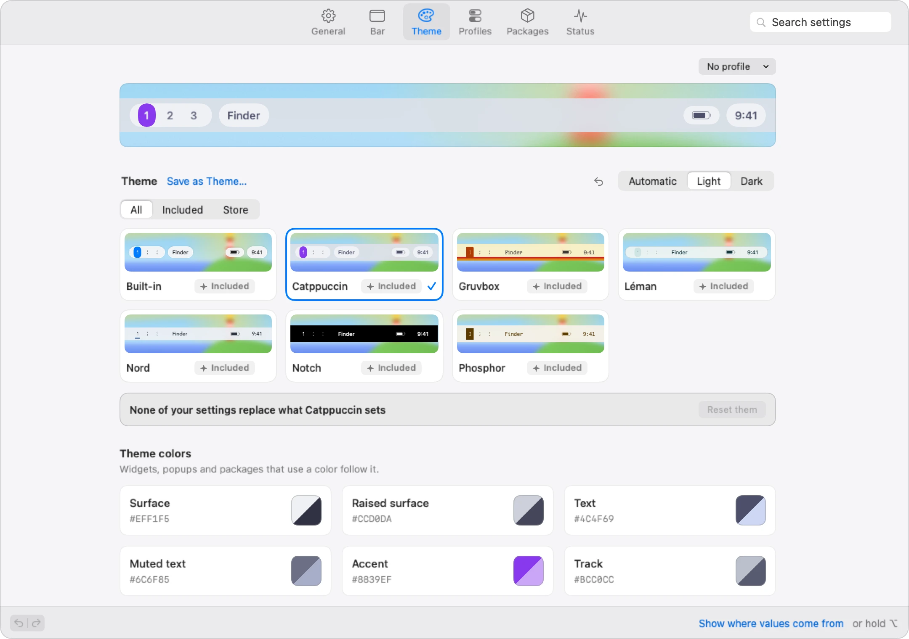

# Settings

<picture>
  <source media="(prefers-color-scheme: dark)" srcset="images/settings-dark.webp">
  
</picture>

Open **Settings…** from the menu-bar icon or by right-clicking the bar, reopen the running app, or run `StableBar --customize`. Its tabs are **General**, **Bar**, **Theme**, **Profiles**, **Packages**, **Status** and **Help**, with General selected on first opening. **Search settings** finds controls by their purpose, including login, permissions, clock format, displays and widget appearance, and jumps to the matching section.

While Settings is open, StableBar appears in the Dock and the ⌘Tab app switcher so you can return after switching apps. Closing Settings removes its Dock icon; the bar keeps running.

Right-click a widget and choose **Edit Widget…** to open its settings directly. Opening or selecting a widget starts on **Content**, and reopening Settings returns the widget inspector to Content. Searches for Style or Behavior still open that tab. Widgets with a custom `actions.rightClick` command keep running it; use **Settings → Bar** or **Edit Bar in Place** to edit those widgets.

**General** contains **Startup → Open at login**, **Native menu bar** auto-hide, reveal delay and **Always hide**, **Windows and notifications** clearance controls, **Hover** delay and inline controls, **Workspaces** connection settings and **Access** permission actions. **Configuration file** opens, reveals or reloads the file; **Command line** installs the [`stablebar` command](command-line.md#install-the-command); **Updates** contains version and update settings; **Uninstall** turns off the menu bar auto-hide that StableBar turned on, then [removes StableBar](getting-started.md#uninstall). Login and permission actions affect macOS immediately; configuration changes use the same saved-change history as the other editor sections.

Outside Applications, **Open at login** offers **Move to Applications**; **Command line** points to that row. The [move](getting-started.md) relaunches StableBar with the same configuration and reopens **General**. You can then turn on Open at login or install the command. If moving fails, use **Show in Finder** in the row. While setup is open, use its **Finishing touches** step to move the app and keep your setup choices.

**Theme** shows a preview and theme cards filtered by **All**, **Included** or **Store**. Select an installed theme or choose **Get** for a Store theme. **Save as Theme…** saves your current look as a new theme. A notice names your settings that override the chosen theme, with **Reset them** to let its values apply. **Automatic**, **Light** and **Dark** control the bar’s appearance. **Theme colors** edits light and dark token values, so widgets, popups and packages that use those tokens follow. **Widgets** sets the default widget text, background, border, shadow and accent colors, font, weight, text size, padding and corner radius. **Popups** sets their background, border, shadow, weight, text size and corner radius over widget defaults. **Bar** sets its background, border, corner radius, height, side inset and spacing. **Liquid Glass** controls [glass surfaces](themes.md#liquid-glass) and transparency. **Animation** picks the [motion](create-a-widget.md#animation) and how popups open. With more than one kind of screen connected, switch from **Every screen** to a screen to set all of these, the theme, the appearance and **Advanced** for that screen only; **Use the theme of every screen** removes its own theme. When a [screen setup](layout.md#screen-setups) has its own bar, **All setups** saves Theme changes in every bar; **This setup only** or **Shared bar only** keeps them in the bar you're editing. The notice about settings that override the theme covers every screen only. **Advanced** opens editors for **Presentation roles**, **Workspace look** and **AeroSpace mode names**. **Bar** in Settings has the same bar and widget settings next to the bar's placement and layout.

**Bar** starts with screen-kind thumbnails and a preview; click a widget in the preview to select it. The list contains **Bar**, **Every widget**, widgets grouped by position, and **Not on this screen**. Each widget's line names the screens it shows on, such as **All screens**, **Laptop only** or **Hidden everywhere**. The **Bar** inspector has **Size**, **Look** and **Placement** tabs for dimensions, background, border, offset, margin and laptop/monitor scale. **Every widget** sets the shared colors, shadow, font, padding, corners and border; widgets with their own values keep them.

Drag widgets in the bar preview or the list, within or between position groups, to move them; widgets that share a group move together, with one Undo step. The preview and screen thumbnails show the same background as setup. Position targets appear along the preview while dragging, including empty positions. The context menu offers **Move up**, **Move down**, **Move to**, **Shows on** and **Remove from bar**; ⌥⌘↑ and ⌥⌘↓ move the selected widget. Empty positions remain drop targets, including both sides of the notch when a display or widget uses them. Eye controls show or hide widgets on the selected screen kind.

**Add widget** opens a searchable grid of built-in, Store and script choices. With more than one kind of screen connected, **Add to** has a checkbox for each; newly added widgets show on the checked ones, all by default, and one must stay checked. Built-in choices stay available offline. Click a choice or select it with the arrow keys and press Return. Adding a package already on the bar selects its widget and keeps its position and compatible settings. Packages with commands, permissions, hosts, required tools or secret settings show their review before you add them. New widgets go to the end of the selected widget's position, or Right if none is selected, and become selected. The **+** beside a position's name, or a click in an empty position, adds to that position instead.

**Remove** below the list, **Remove from bar** in the context menu and the widget's **More** menu delete a widget defined in your configuration. For a widget from a package, they take the package off this bar, like **Remove from bar…** in **Packages**, so all of its widgets go and **Add widget** offers it again. A widget from an included file can't be removed in Settings: remove it from that file, or choose **Hidden everywhere**. **Undo** brings a removed widget back.

Choose **Edit Bar in Place** in **Settings → Bar**, or in the bar's right-click or menu-bar icon menu, to arrange widgets on every display. While setup is open, the right-click and menu-bar icon menus leave it out and **Settings → Bar** shows it dimmed, since setup saves its choices only when you finish; setup's last card offers it then. Widgets keep their look and size; the one under the pointer is shaded, and the pointer becomes a hand that grabs it while you drag. Each position has a softly outlined tray, including empty positions; position names appear only while dragging, in room each tray keeps for them. Trays tint the theme’s bar surface, and their outlines, **+** and names are drawn to read on it. On a theme that leaves the bar see-through, such as Built-in, each tray gets a light or dark backing that the widgets’ text reads on, so the trays stay readable over any wallpaper. The bar grows just enough for the trays and badges. Widgets hidden by their output or screen choice appear as named placeholders with a crossed-out eye; empty widgets show their names too. Turned-off widgets aren't shown; turn one on again in **Settings → Bar**, or add a Store package again with **+**. Other names appear in tooltips. Drag a widget within or between positions: it lifts off the bar, the other widgets slide aside to make room, and it settles into the gap when you drop it. Grouped widgets move together. With Reduce Motion on, widgets move without sliding. If a position is too crowded to fit, its widgets continue on more rows inside its tray and the bar grows taller while you edit, so every widget stays on the screen. A group wider than its whole tray takes a row of its own that scrolls sideways: swipe, or scroll with Shift held, to reach the rest of it. Drag a widget onto any row; the bar returns to its usual height when you finish. **+** opens an **Add here** popover below it, with search and a two-column choice of widgets. Adding puts the widget exactly where that **+** sits. With more than one kind of screen connected, the popover has an **Add to** checkbox for each; the widget shows on the checked ones, all by default. Packages with commands, permissions, hosts, required tools or secret settings are reviewed in the popover first. The **−** badge on a widget’s top-left corner removes it from the bar; a widget from a package takes its package off the bar, and a widget from an include is turned off. Click a widget to open its settings here. Its usual clicks, popups and mouse actions pause while editing. The update tile isn't shown while editing the bar. The widget's context menu also offers **Move Left**, **Move Right**, **Move To** and **Shows On**, with the same screen choices as in Settings. With VoiceOver, use the widget's **Move left** and **Move right** accessibility actions. Changes save automatically. **Undo** and **Done** sit in a small panel below the bar. Use **Undo**, or ⌘Z and ⇧⌘Z while the bar has focus, to undo and redo through the same history as Settings. **Esc** closes an open Add here popover first. **Done**, **Esc** while the bar has focus, **Finish Editing Bar** or an explicit or external configuration reload restores the normal bar. Automatic profile changes keep editing open. Temporary command-line changes stay separate and unsaved.

Widgets use your chosen IDs as names. Widgets added in Settings use their package name, short text or type, with numbers to tell matching names apart. A selected widget has **Content**, **Style** and **Behavior** inspector tabs. Content contains text, symbols, clock format and ordinary package settings; **Open package** opens shared settings and credentials in Packages. Style edits colors, font, size, padding, corners, border and workspace presentation. **Widget background**, **Popup background** and **Tooltip background** control [each surface separately](widgets.md#backgrounds); making the widget transparent leaves its popup and tooltip backgrounds alone. Behavior contains click actions, tooltip, popup-on-hover and position. **Shows on**, beside the widget's name, chooses its screens: **All screens**, **Only on** the selected screen, each kind of screen, **Other rules** for the active or main screen, external screens and screens with or without a notch, or **Hidden everywhere**, which turns the widget off and keeps its settings. Hidden widgets offer **Show here**; widgets with a problem offer **Troubleshoot…**.

Choose an app or web page to open on click. Workspaces offers **Show each window**, **Title length**, **Magnify on hover** and **Magnification**, and keeps its own clicks to switch workspaces or focus windows. App menus keeps its clicks to open menus; Spacer has no click control. The widget’s **More** menu offers **Edit as JSON…**, **Copy widget ID**, **Presentation role**, **Transition** where supported, **Troubleshoot…**, **Reset to defaults…** and **Remove from bar**. **Reset to defaults…** asks first, then takes a widget from a package or imported file back to how that file defines it, keeping its position and screens. For a widget defined in your configuration, it removes its style, background overrides, role, rules, transition, tooltip, click action, format and workspace options, and keeps what it shows and where it sits. Existing commands, menus and detailed layouts remain available through JSON. A color can follow a theme token such as Text or Accent, or use a custom light and dark pair.

A revert arrow beside a changed value restores its inherited value; hover over it for an explanation. **Show where values come from**, or holding ⌥, reveals source links and information buttons. Click one, or choose **Show value sources** from the revert arrow’s context menu, to see contributing sources with the winning value first. The source popover warns when a higher-priority source overrides your saved value, offers **Open profile** when that source is a profile, and **Reset** when a saved value can be removed. Reset restores inheritance; writing `null` clears that level and is a different operation. Opening a menu or selecting its current value leaves it unchanged.

Configuration changes in Bar, Theme, Profiles and General apply immediately and save to your main file, or to the current [screen setup](layout.md#screen-setups)'s own bar when it has one. Theme changes go to every bar unless you choose **This setup only** or **Shared bar only**. Ordinary settings for active packages use the same automatic save and Undo history; package drafts and credential edits have their own explicit actions. Number and text fields, sliders and color pickers update the bar once you pause, and typing or dragging saves when you pause; closing Settings or quitting StableBar saves pending configuration changes. **Undo** (⌘Z) discards a pending change or reverses the last saved change, and **Redo** (⇧⌘Z) restores changes, with one step per burst. If the file changes outside Settings, affected history is cleared so Undo cannot overwrite those changes. An invalid change is rejected and its error is shown. If a pending change cannot be saved, it is discarded with an explanation so you can keep using Settings or quit.

**Profiles** lists [profiles](configuration.md#theme-tokens-and-automatic-profiles) in configuration order, edits their conditions and enabled state, and lists **What it changes**. **Edit the bar for this profile** uses Bar and Theme with a shared banner and temporary preview; **Done** returns to Profiles and ends that editing preview. **Preview now** separately pins a profile until **Stop previewing** resumes automatic matching. **Edit as JSON…** applies configuration edits explicitly. Profile reordering is not available in Settings.

**Packages** reviews local folders and [Store](packages.md#store) packages, lists their included widgets and requirements, and provides **Add to bar**, ordinary settings, credential saves, version selection and removal. Installing files, adding widgets, turning off a package and uninstalling a version are separate states. Themes are primarily browsed in Theme; selecting an installed theme in Packages still offers **Use theme**. **Sources…**, next to **Open a folder…**, lists the StableBar Store and your [private sources](packages.md#private-sources). Add one with **Add source…**, or choose **Edit** to change a source's name, URL or token, or to remove it.

**Status** shows widget health and the last successful source update, with clear states for failures, missing access, disabled or paused widgets, connections and updates. Select a widget to allow access, **Refresh data**, **Restart connection**, reconnect workspaces or **Configure widget**. Shared data sources name the other widgets an action affects. A configuration error, a workspace error or a configuration warning also appears in the bar's right-click menu and the menu-bar icon's menu, shortened to its first 32 characters; choose it to open Status, which shows the whole message.

Opening Status does not resume a hidden provider. **Resume for testing** keeps a paused source active until you choose **Stop testing**, select another widget, leave Status or close Settings. **Technical details** contains run duration, completed-command CPU time, counters, **Test click action** and **Broadcast event to subscribers**. Broadcasting an event can refresh other subscribed widgets too.

**Capture output and configuration** creates a snapshot only when requested. It includes the composed configuration, source paths, resolved styles and presentation layers, widget/provider output, graph samples and diagnostics. JSON formatting runs off the main thread. The snapshot is labelled with its capture time and stays unchanged until **Refresh snapshot**; **Copy snapshot** copies that captured text. Snapshot refresh reads current data and does not itself restart a source.

**Crashes**, in the Status sidebar, lists the times StableBar quit unexpectedly in the last 30 days, read from the crash reports macOS saves in `~/Library/Logs/DiagnosticReports`. Each crash shows the StableBar version, the exception, where in StableBar it happened and any error message. **Copy report** copies a summary to paste into an issue, with your home folder written as `~`. **Report on GitHub…** opens the bug report form in your browser with that summary filled in; nothing is sent until you submit the form. **Show in Finder** reveals the macOS report, and **Dismiss** hides a crash from the list without deleting the report. StableBar sends nothing on its own and stores only which crashes you have seen or dismissed. After a new crash, the bar's right-click menu and its menu-bar icon show **StableBar Quit Unexpectedly…** until you open Crashes.

**Report a problem**, at the bottom of the Status overview, gathers what a bug report needs: StableBar's version and build, macOS, your Mac, each display (built-in or external, size, scale, notch), the configuration file and whether it's valid, the theme and turned-on packages with their versions, the workspace manager with its version and connection, Accessibility and Calendars access, active profiles, configuration and widget errors, and crashes from the last 30 days. Your home folder is written as `~`, and no configuration values are included, so package secrets stay out; widget errors show what their scripts printed, so check them before sharing. **Copy bug report** copies it as Markdown, and **Send feedback…** opens Send feedback in Help, with the report attached. `StableBar --report` prints the same report in a terminal.

**Help** answers common questions and sends feedback. **Help…** in the menu-bar icon's menu opens it. Its sidebar also opens the user guide, runs setup again and stars StableBar on GitHub.

**Questions** shows the guide's [Questions](questions.md) page as it was when this version of StableBar was built. Search filters the questions, and each answer links to the guide's full section.

**Send feedback** turns a problem or an idea into a GitHub issue. **Send Feedback…** in the menu-bar icon's menu and the bar's right-click menu opens it too. Choose **Something's wrong** or **An idea**, then fill in a title and the questions of the matching issue form. A problem includes the bug report from Status and, when StableBar crashed in the last 30 days, the crash you choose. As you type the title, questions from Questions that may answer it appear. **Find similar issues** searches open and closed issues for the title's words longer than three letters, sending only those words to GitHub, so you can comment on an existing issue instead. Then send it one of these ways:

- **Open on GitHub…** fills in the issue form in your browser; nothing is sent until you submit it. When your answers are too long for the form's address, it turns off: post or copy them instead.
- **Post as @account…** appears when the [GitHub CLI](https://cli.github.com) (`gh`) is installed and signed in. Once every question is answered and you confirm, it posts the issue as that account and links to it.
- **Investigate with Claude Code…** or **Codex…** appears when that coding agent is on your `PATH`. It opens Terminal on [`StableBar triage`](command-line.md#triage), which starts from what you wrote, looks into the problem on your Mac and asks before posting anything.
- **Copy** copies the title and answers as Markdown.

What you write stays in Send feedback until StableBar quits, and clears once it's posted with the GitHub CLI.

**Settings → General → Updates** shows a released app's channel (Stable or Beta), full version and build number. Local app builds show Development and their source revision; builds without version metadata show Development with the version unavailable. It also checks for [updates](getting-started.md#updates), chooses the update track and turns automatic checks and installs on or off.
