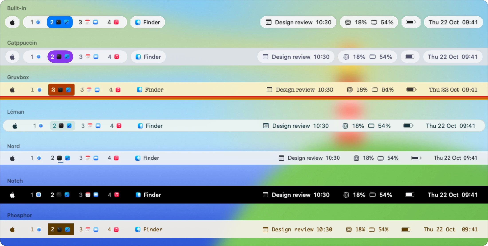

# Themes

<picture>
  <source media="(prefers-color-scheme: dark)" srcset="images/themes-dark.webp">
  
</picture>

StableBar ships with six themes and the Built-in fallback. Themes follow the system's appearance, or the one `bar.appearance` sets. Notch stays black in both appearances.

| Theme | ID | Look |
| --- | --- | --- |
| **Built-in** | none | Each widget is its own floating tile. |
| **Léman** | `leman` | A rounded floating bar in lake blue-green colors, with an inset teal tint for the focused workspace. |
| **Notch** | `notch` | A pure black strip that blends into the MacBook notch, with a cyan accent. |
| **Catppuccin** | `catppuccin` | Rounded pills on a solid strip in Latte and Mocha colors, with a Mauve pill for the focused workspace. |
| **Nord** | `nord` | A slim 30 pt strip in Snow Storm and Polar Night colors, set in Avenir Next, with a short frost dash under the focused workspace. |
| **Gruvbox** | `gruvbox` | A strip in Gruvbox colors, set in American Typewriter, with red, orange and yellow 70s stripes along its bottom and an orange block for the focused workspace. |
| **Phosphor** | `phosphor` | An amber CRT terminal: glowing Monaco on black in dark, brown ink on paper in light, with the focused workspace in reverse video. |

Choose one in setup or in **Settings → Theme**. Theme cards show the same sample bar in each theme's style: three workspaces, Finder, a battery and a clock. The sample shows the theme's bar, widget tiles, fonts, colors and workspace indicator, in the light or dark appearance your bar uses now. Click a card to apply and save it immediately; a checkmark marks your choice, and **Undo** restores the previous theme. You can also select a theme that ships with StableBar by its ID:

```json
{ "theme": { "id": "catppuccin" } }
```

To try themes on your real bar, choose **Try Themes…** from the bar's right-click menu or its menu-bar icon. A small panel opens below the bar on that screen. Use **←** and **→** or the arrow buttons to cycle through the themes that ship with StableBar, starting with Built-in, then your installed themes, in the gallery's order; every display changes together. **Return** or **Keep** saves the shown theme, and **Undo** in Settings reverses it. **Esc**, **Cancel** or a click outside restores the previous look without saving. Quitting while trying also leaves the saved theme alone. Opening **Edit Bar in Place** cancels a theme trial; starting **Try Themes…** finishes editing the bar. Temporary command-line changes stay applied and unsaved throughout. **Keep windows clear** uses the saved bar’s size until you choose **Keep**.

Older configurations can still select `slate`, `paper`, `graphite`, `menu-bar`, `island`, `minimal`, `terminal`, `blueprint`, `broadsheet`, `brutalist`, `everforest`, `handheld`, `kanagawa`, `platinum`, `rose-pine` or `synthwave` without a version. Their appearance and overrides are preserved on update. The active theme is shown as **Custom**; the old themes are not offered as separate choices in **Theme**. Choosing a new theme replaces Custom, and Undo restores it.

Without `theme`, StableBar uses Built-in. Built-in also loads under every other theme, so a theme only needs what it changes: one that defines only tokens restyles widgets through Built-in's `defaults`, and anything it leaves out keeps Built-in's value.

A theme is a package whose `package.json` sets `"kind": "theme"`. Its configuration can contain only `tokens`, `defaults`, `popupDefaults`, `groupDefaults`, `roles`, `workspaceDefaults`, `bar`, `groups` and `profiles`, plus includes inside the package. Widgets, templates, widget overrides, popups, providers, environment variables and any other key are rejected when the theme is reviewed, installed or loaded, so a theme runs no commands and needs no command review. The themes that ship with StableBar are in [Resources/themes](../Resources/themes); [Catppuccin](../Resources/themes/catppuccin/config.json) defines every token below. Give each color a light and a dark value, such as `{ "light": "#1f2329", "dark": "#e6e9ef" }`, instead of a dark profile.

A theme can change the whole look, not only its colors. [Nord](../Resources/themes/nord/config.json) draws the strip with `bar.style` and removes the widget tiles by setting `background`, `borderColor` and `shadowColor` to `null` in `defaults`. Popups would show the system's material instead of the theme's colors, so it gives popups their own in `popupDefaults`. [Léman](../Resources/themes/leman/config.json) adds `bar.margin` and a corner radius so the strip floats.

A theme can also fill its groups with [`members`](layout.md#adaptive-layout-and-groups), such as pills for the clock and the status widgets, and give every group a base look with [`groupDefaults`](layout.md#adaptive-layout-and-groups), its own groups and the ones people make. Such a theme should set [`minimumVersion`](packages.md#store) to the first release with what it uses: an older StableBar then refuses to install it. One that finds it already installed skips `members`, but stops at `groupDefaults` with an error.

Install your own theme like any other package, then select it with its version:

```json
{ "theme": { "id": "my-theme", "version": "1.0.0" } }
```

Only one theme is active: `theme` must name a theme, and `packages` cannot list one. An installed theme accepts the same `enabled` and `settings` as a package selection, and you can also enable it in **Settings → Store**. Widget packages load first, then Built-in, then the selected theme, then includes and the main file. A theme's tokens, `defaults` and `bar` settings override a widget package's, and yours override the theme's. Profiles merge by name across these layers, keeping their order; later properties override earlier ones. A theme’s profiles remain unless you disable them with `"enabled": false`. **Built-in** in setup removes `theme`. In Theme it removes the main file’s selection, or selects Built-in explicitly when an included file chooses another theme. Choosing a theme in Theme or Try Themes replaces the version and settings inherited from an included file.

When your main file sets values that the selected theme also sets, Theme names them below the gallery. **Reset them** removes those values in one saved, undoable change. This includes bar dimensions, shared styles and a widget’s own style where it overrides the theme’s defaults or that widget’s role. Theme color changes count too, including colors inherited from Built-in. Active profiles in your main file are included; included files, templates and packages are left alone. The Light/Dark/Automatic choice is kept. Other settings still follow the usual layer order.

**Save as Theme…**, beside the **Theme** heading, saves your look as a theme of its own. Enter a name, and StableBar installs a theme package in `packages/<id>/1.0.0` beside your configuration and selects it. The package holds the current theme with your changes merged in, and its ID comes from the name: “My Léman” becomes `my-leman`. Your `defaults`, `popupDefaults`, `groupDefaults`, `roles`, `workspaceDefaults`, `groups`, theme colors and any token the current theme defines, and the bar's `height`, `margin`, `inset`, `spacing`, `background`, `style`, `notchWidth`, `notchSpacing` and `fillNotch` move from your main file into the theme. The bar looks the same, and choosing another theme later replaces the whole look. Tokens you named yourself are copied into the theme and also stay in your file, so your widgets can still use them under other themes. Widget styles, profiles, screen settings, included files and the other `bar` settings stay where they are. One **Undo** restores the previous theme and your values; the saved theme stays installed. Saving again under the same name installs the next version, such as 1.0.1. For an installed theme, **Show in Finder** opens its folder so you can share it. Both appear with **Every screen** selected and while you aren't editing a profile.

[Make a theme on the website](https://stablebar.app/create-theme.html) to change a theme's colors and shape. Under **Workspaces**, **App icon size** sets native app icons' width and height together, with sample icons in the live preview. Its color picker shows the base theme's color and the colors you used recently, and **Reset** beside a changed setting brings back the base theme's value. **Try in StableBar** opens it in **Settings → Theme** as a theme link, described below, with StableBar 0.16.0 or later. Or download the zip, which holds a folder with `package.json` and `config.json`. Unzip it, open **Settings → Packages → Open a folder…**, choose the folder and select **Use theme**. To share it in the [Store](https://github.com/Seb-GRAF/stablebar-packages), choose **Submit to the Store** on the website for the steps to open a pull request. The Store's table requires a name and description with no `|` or line breaks; you can still download and share the theme.

**Theme links** (`stablebar://theme?v=1&package=…&config=…`) carry a theme's `package.json` and `config.json`. Opening one shows a banner card above the gallery in **Settings → Theme**; nothing is installed and your bar stays as it is. **Try on Bar** previews it temporarily. **Keep** after trying, or **Use theme** directly, installs and saves it like a Store theme, following the gallery's screen and **All setups**/**This setup only**/**Shared bar only** choice. **Cancel** returns to your saved theme and keeps the card; **Dismiss** removes the card and deletes the linked copy. Your own settings still override the theme; **Reset them** removes those overrides with **Every screen** selected. If your Mac doesn't have a font the theme uses, the text appears in the system font.

If you choose or try another theme while a linked theme installs, your newer choice is kept.
The linked theme stays installed, with its card ready to use again.

Links accept `tokens`, `defaults`, `popupDefaults`, `groupDefaults`, `roles`, `workspaceDefaults`, `bar`,
`groups` and `profiles`. Other keys are refused, including legacy `customization` and `removedWidgets`; an
empty `widgets` list is ignored. Includes, screenshots and extra files are refused. At the root and
in every profile, `bar` must be an object written out with only `height`, `margin`, `inset`,
`spacing`, `background`, `style`, `notchWidth`, `notchSpacing`, `fillNotch` and `popupOffset`.
Colors inside it may use tokens or settings with `choices`; free-text string settings under `bar`
are refused. Every numeric value under `bar`, including nested styles, states and gradients, must
be a finite JSON number literal within its permitted range; references that can supply numbers are
refused. Bounds follow the full property path: `bar.height` uses 16…100, while `bar.style.height`
uses 0…1,000. Properties with Settings controls follow those ranges, and other numeric values have
conservative bounds; [the decision](../DECISIONS.md#code) lists them. A link cannot change the bar's
edge, its offset or the menu bar's auto-hide.

Links have limits on their length, decoded file size, nesting, profiles and total JSON values; [the decision](../DECISIONS.md#code) records the exact limits. For a theme that exceeds a link's limits, install the theme's folder instead, with **Open a folder…** in **Settings → Store**. Installed versions are immutable: different file contents under the same ID and version are refused, so raise the version on the page and open the new link.

**Bar links** (`stablebar://bar?v=1&d=…`) share a whole bar: its look and its built-in and Store widgets, in their places. **Bar link** in [**Share My Bar…**](getting-started.md#share-your-bar) makes one from the bar of one screen, as it looks there now with your active profiles, and copies or shares a `https://stablebar.app/bar.html#…` link: the page opens StableBar, or offers the download. **What it shares** lists what the link carries and what stays on your Mac. A link never carries script widgets, custom providers, widgets from folders or private sources, profiles, screen layouts, includes or `environment`, nor anything that runs or opens something, such as `onClick`, `open`, `menu`, `actions` and popup buttons. A Store widget carries its version and its number, on/off and choice settings; secret and free-text settings, such as a city or an account, stay on your Mac. The look keeps only the theme's tokens and those it uses, so a token that holds something else, such as a provider's header, stays on your Mac too.

Opening a bar link shows a card above the gallery in **Settings → Theme** with a preview of the shared bar: its widgets in their places and the shared look, with sample data, and each Store widget as its package's name. Below it, the look and each widget have a checkbox, all ticked: built-in widgets under **Built in**, and Store widgets under **From the Store** with a line that says what their package does, such as “Runs a script”, “Connects to api.open-meteo.com”, “Needs Accessibility access” or “Runs nothing, stays offline”. A widget whose package the Store doesn't list is left out, unticked, and says so. Untick a widget to leave it out of the preview, **Try on Bar** and **Use this bar**; a Store package is installed only when a ticked widget needs it, and an unticked widget of that package comes hidden. Untick the look to keep yours: the preview shows your look, and **Try on Bar** and **Use this bar** change only your widgets. With no widget ticked, they change only your look. The list can't change while you try the bar. Your bar stays as it is. **Try on Bar** and **Use this bar** first install the ticked widgets' Store packages, the version the Store lists. Those that need no review install right away; the others open one Store review that says what they run, reach and need, and shows each of them, with the link's settings and their secret settings to fill in. **Add and Try** or **Add and Use this bar** adds them all and goes on. **Try on Bar** then shows the shared bar on yours: **Cancel** returns to your bar, **Keep** uses it. **Use this bar** replaces your widgets, Store widgets, their order and places, your screens' layouts and your profiles' widget changes, and, with the look ticked, installs it as a theme named after the sender's with “(shared)”, which stays in the gallery. With the look ticked and **Every screen** selected, it also removes the look settings of your main file that **Save as Theme…** would move, so the look shows as it was shared, unless one of your active profiles changes it; with one screen selected, only that screen's theme changes. It follows the **All setups**/**This setup only** choice, and one **Undo** brings your bar back. Widgets that your included files add stay, and the Store widgets it installed stay installed. The **×** in its corner removes the card. Bar links have limits on their length, size, nesting and values, and the look follows the theme link rules above; [the decision](../DECISIONS.md#code) lists them.

[Tonhalle Line](../examples/packages/tonhalle-line) is an installable theme with a 38 pt Helvetica strip in forest ink and warm paper, a matching light palette, and brass warning colors. Version **1.1.0** adds a Light 16 pt `time` role, popup heading/key/value/button/meter roles, a 2 pt workspace underline below the strip, and a four-edge brass outline for `mode.command`. Version **1.1.1** marks the focused window in workspace widgets with a soft box, its corners rounded 4 pt, reaching 2 pt past the icon on each side and 1 pt above and below; set the widget's `focusedWindowStyle` to `null` to turn it off. Other labels remain 13 pt regular; a `secondary` date stays smaller. Install its folder through **Settings → Store**, then select it in Theme:

```json
{ "theme": { "id": "tonhalle-line", "version": "1.1.1" } }
```

Version 1.1.0 requires a StableBar build with shared presentation support, and 1.1.1 requires StableBar 0.15 or later; earlier builds reject their new properties. Installed versions are immutable: if you installed an earlier version, install 1.1.1 alongside it, then select 1.1.1. Keep the theme selected through `theme`; do not include or copy its styles into your configuration. That lets switching themes replace its appearance. User overrides still win.

The [presentation example](../examples/presentation/config.json) separates the time and date clocks, annotates popup elements, and owns a horizontal music-popup layout. It has 18 widgets, a shared sample provider, a group, constrained labels, a disabled widget and an event-driven mode label. Copy its `config.json`, `sample.json` and `mode.sh` together into a scratch directory and install the theme for that configuration. Its sample data is local; its buttons open the named macOS applications/settings. Change `modeAliases` to match your local AeroSpace names. The example maps `tailing` to `command`; the theme contains no local mode names and runs no commands. Use Dark Appearance for the original ink palette. A theme switch closes an open popup; reopen it to see the new role styling and unchanged layout.

Popups inherit `popupDefaults` and then `defaults`, except padding and spacing, which come from `popupDefaults` alone, and the workspace highlight uses `defaults.accent`. Every theme defines these tokens, so widgets, widget packages, popups, layouts and workspace styles can use them, for example `"foreground": "@token.textMuted"`:

| Token | Use |
| --- | --- |
| `surface` | Widget background |
| `surfaceRaised` | Hover background and raised surfaces |
| `text` | Primary text |
| `textMuted` | Secondary text |
| `accent` | Highlights, the workspace indicator and progress fills |
| `track` | Progress and graph tracks |
| `hairline` | Borders and dividers |
| `warning` | Warning text or fills |
| `critical` | Critical text or fills |

A reference to a token that no layer defines is an error. Built-in defines all of these, so your own widgets can use them under any theme. Their names are reserved for colors: Built-in's `defaults` use `text`, `surface`, `surfaceRaised` and `accent`, so a token of yours with one of these names replaces the theme's color and must be a color. A widget package should still define fallback values for the shared tokens it uses, so it passes review on its own; Built-in and any other theme replace them. StableBar also rejects references nested more than 64 levels deep, references whose expansion is too large, and references that need more tracking than StableBar allows.

A theme can style sliders in popups, hover controls and the built-in Sound widget through
`roles.slider`. A nonempty style makes plain sliders filled bars; an empty role leaves the
native control. Widgets can opt out with `"filled": false` or keep an explicit filled style
with `"filled": true`. See [presentation roles](styling.md#presentation-roles-and-workspace-defaults).
Widget layouts and their Display choices remain part of the widget configuration.

## Liquid Glass

`bar.glass` is experimental. It draws backgrounds as native Liquid Glass, the material of the macOS 26 Dock, on top of any theme:

```json
"bar": { "glass": { "enabled": true, "transparency": 0.4 } }
```

Every widget, popup and bar that has a background becomes glass in the same shape, tinted with that background's color, so hover, open and data-state colors still show. Borders, corners, shadows and text keep the theme's style. Transparent backgrounds stay transparent. `transparency` (0.3 by default) sets how much glass shows through the color, from `0`, the theme's color, to `1`, pure glass; the higher it is, the more a busy or bright wallpaper can make text hard to read. StableBar uses Apple's clear glass with the theme's color as its dimming layer: the frosted regular glass switches small elements between light and dark to match what is behind them, which would leave theme text unreadable. Set `widgets`, `popups` or `bar` to `false` to keep that surface's plain color. Before macOS 26, StableBar draws the colors as usual.

Glass in a background window renders flat, without refraction. StableBar's bar and popups report themselves as active to AppKit so the glass refracts. The glass setting doesn't change their keyboard behavior.

## Reduce Transparency and Increase Contrast

StableBar follows **Reduce transparency** and **Increase contrast** in **System Settings → Accessibility → Display**, and changes as soon as you switch either. No setting in your configuration turns them on or off.

With Reduce transparency on, the bar and popups are opaque. Liquid Glass and the popups' system material are off, and their colors lose any transparency. A see-through strip, such as Built-in's between its tiles, takes the popups' color, the surface the theme sets its text on, or the window background color when popups have none. Widgets keep their own colors, hover and data-state tints included, since they now sit on an opaque bar.

With Increase contrast on, popups, tooltips and widgets that have a background, such as Built-in's tiles or a hover highlight, are outlined in their text color, at the theme's border width and at least 1 point. A [group](layout.md#adaptive-layout-and-groups) with a background gets one outline around its widgets, in the widgets' default text color; a flared group still draws none. macOS turns on Reduce transparency with Increase contrast, so text sits on an opaque strip then, unless the theme's popup background is clear, in whole or, for a gradient, in part.
